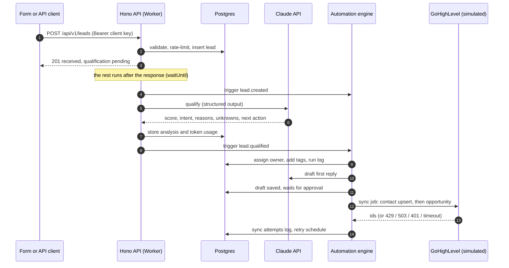

# Architecture

LeadFlow AI is one TypeScript codebase that runs in two places: a Cloudflare Worker (the live demo) and a Node process (Docker, local development). Both entry points (`api/src/worker.ts`, `api/src/node.ts`) hand requests to the same Hono app in `api/src/app.ts`.

## Request path

The answer to the caller never waits for the AI or the CRM. If the Worker is stopped part way through, the lead is still stored. Its sync job stays in the outbox, and the scheduled sweep (`POST /api/cron`, every 15 minutes from GitHub Actions) picks it up.

## Data model

All tables are in `db/migrations/001_init.sql`.

| Area | Tables | Notes |
|---|---|---|
| Tenancy | `agencies`, `clients`, `users`, `memberships` | An agency has clients. People belong to the agency and are given access to clients through memberships. Each demo visitor gets their own agency. |
| Leads | `leads`, `messages`, `activities`, `campaigns` | `leads.analysis` holds the AI result as JSON; the score, priority and intent are also stored as columns for filtering. `first_response_at` drives the speed-to-lead numbers. |
| Automations | `automations`, `automation_runs` | Each run stores its steps as JSON. A unique key on (automation, lead) means each automation runs at most once per lead. |
| CRM sync | `sync_jobs`, `sync_attempts` | The outbox: one job per lead, plus every HTTP attempt with status, outcome and duration. |
| Inbound events | `webhook_events` | A unique key on (agency, provider, event id) drops repeated deliveries. |
| Simulated CRM | `ghl_contacts`, `ghl_opportunities` | Storage for the simulated GoHighLevel. It is kept separate from the app's own tables, as a real CRM would be. |
| Guardrails | `ai_usage`, `rate_limits` | Token counts and latency for each AI call; fixed-window counters. |

## Access control

`services/access.ts` decides who may do what, and every sandbox route goes through it:

- `requireClient(sql, actor, clientId, 'read' | 'write')`
- `requireLead(...)`, which resolves the lead's client first

| Role | Sees | Can change |
|---|---|---|
| Agency admin | every client, AI costs, integrations | everything |
| Account manager | the clients they are a member of | leads, drafts and automations for those clients |
| Client viewer | their one client | nothing (read only) |

The web app hides controls the user can't use, but the API is the boundary. The integration tests call the services directly to check these rules.

## AI layer

`api/src/ai/` has three tasks, each a system prompt plus a Zod schema:

| Task | Input | Output |
|---|---|---|
| `qualify` | the client's ideal-customer rules and the lead | score 0–100, intent, confidence, reasons (each with a sign), unknowns, next action with timing, extracted facts |
| `draft` | the lead, analysis and conversation, and the client's offers and booking link | SMS (under 300 characters) or email (under 140 words), a rationale, and the facts it used |
| `insights` | precomputed analytics for one client | exactly three findings, each tied to the numbers it uses |

How the calls are made:

- `runTask` calls `messages.parse` with the schema as the output format and low effort, then checks for `refusal` and `max_tokens` stop reasons.
- It logs the tokens and latency of every call.
- It uses the rule-based version of the task, labelled `provider: "demo"`, when there is no key, a rate limit is reached, or the call fails.
- Lead text goes inside a block marked as untrusted data.
- Code, not the model, derives the final priority from the score and clamps every number.

The sandbox seed uses analyses and drafts that Claude produced once for the fictional leads (`api/scripts/build-seed.ts`). A new visitor sees real model output without 50 AI calls each time.

## GoHighLevel sync

The client in `api/src/ghl/client.ts` speaks the LeadConnector v2 API:

- Base URL `services.leadconnectorhq.com`, the `Version: 2021-07-28` header and a bearer token.
- Contacts upsert, opportunity search, create and update.

In the demo, its transport is pointed at `ghl/mock.ts`, a simulation of those endpoints with switchable failure modes.

Each run of a sync job makes the CRM match the lead:

1. **Upsert the contact.** GHL matches on email or phone, so repeating it is safe.
2. **Update the opportunity** if its id is known.
3. **Search before creating.** If an earlier attempt timed out, it may have created the opportunity without us seeing the reply. In that case search for it by contact first.
4. **Create it** only if it really is missing.

How each failure is handled:

| Failure | Handling |
|---|---|
| 429 rate limited | wait for `Retry-After` or back off exponentially with jitter, then retry |
| 503 unavailable | back off and retry |
| timeout or 500 | mark the job *uncertain*, so the next attempt searches before creating |
| 401 | refresh the access token once, then retry |
| 400 or 422 | stop; the job is failed and shown to a person |

After six attempts a job is failed and shown on the integrations page. A sync is triggered:

- by the "sync to CRM" automation action,
- by stage changes on leads already in the CRM,
- by the **Sync now** button,
- and by the scheduled sweep for jobs that are due.

## Inbound webhooks

`POST /api/v1/webhooks/ghl` accepts GoHighLevel events:

1. It verifies an HMAC-SHA256 signature over the raw body.
2. It records the event id, ignoring repeats.
3. For `InboundMessage`, it finds the lead by GHL contact id, attaches the reply to the conversation and asks Claude for a suggested answer, which waits for approval.

**Simulate a reply** on a lead page sends a correctly signed event to this endpoint.

## Performance notes

- The Worker uses targeted placement in `aws:eu-west-2`, next to the Neon database in London. It connects through Hyperdrive with query caching off.
  - Before this, a visitor in Manila waited about 10 s for a new sandbox, because every query crossed half the world.
  - After it, a new sandbox takes under a second and a database round trip about 15 ms.
- A new sandbox is seeded with one multi-row insert per table, sent in a pipeline inside one transaction.
- Independent queries on a page (for example the overview's lists and totals) are issued together.
